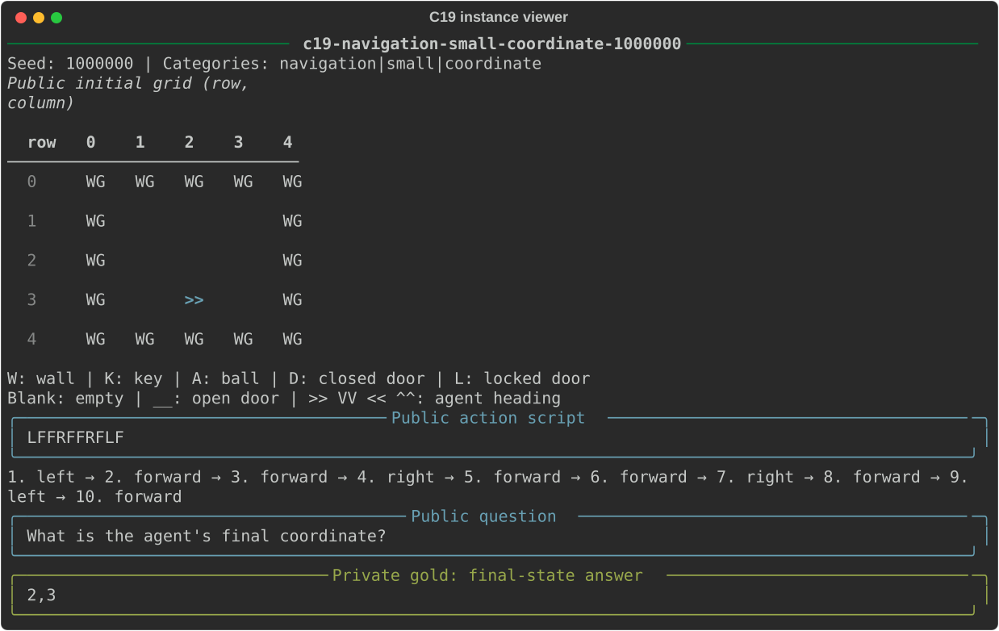

# whetstone-envs

[](https://github.com/danielle-rothermel/whetstone-envs/actions/workflows/ci.yml)

Reproducible quick-test environment contracts and task families.

## Visualize task examples

Run these commands from the repository root. Each script generates local
examples and shows their IDs, seeds, categories, public inputs, and clearly
labeled private gold. No model or provider calls are made.

| Task | Command | Display |
| --- | --- | --- |
| C11: JSON canonicalization | `uv run python scripts/c11/viz.py` | Original and canonical JSON, with escaped views to expose whitespace and control characters. |
| C18: deductive entailment | `uv run --extra c18 python scripts/c18/viz.py` | Facts, rules, query, expected verdict, deduction depth, and distractor policy. |
| C19: MiniGrid state prediction | `uv run python scripts/c19/viz.py` | Grid with row/column coordinates, ordered actions, question, and expected final-state answer. |
| C22: instruction constraints | `uv run python scripts/c22/viz.py` | Numbered constraints, private scoring parameters, and passing/failing responses with overall and per-constraint scores. |
| C23: string induction | `uv run python scripts/c23/viz.py` | Demonstrations, quoted query and expected output, rule family, and context length. |

Every script accepts `--count N` (default `1`) and `--probes` to show both
rendered probe prompts. C11, C18, C19, and C23 generate small balanced pools
with `--n-per-category N` (default `1`); increase it when requesting more
examples than the pool contains. `--count` selects the first instances in
pool order. C11, C18, and C19 also accept `--seed-start`.

Use `--hard` for C18's hard configuration or `--preset hard` for C22's fixed
hard pool. C22 and C23 retain their configured generation seeds. C23 instances
retain expected output rather than the sampled hidden rule itself.

For each C22 instance, the viewer constructs a passing response and modifies it
to fail a constraint. Both responses are scored by C22's actual oracle. These
are illustrative responses; other responses can also satisfy the same stack.

```bash
uv run python scripts/c11/viz.py --count 5 --probes
uv run --extra c18 python scripts/c18/viz.py --hard --count 3
uv run python scripts/c22/viz.py --preset hard --count 3
```

<details>
<summary>C19 terminal preview</summary>



</details>

## Scope

This repo owns the environment data and evaluation rules shared by Whetstone's
quick-test task families. Core packages have no dependency on optimizer or
execution-contract code:

- [**Instances and groups**][instances-source] define immutable task inputs,
  private gold data, generation seeds, instance categories, public prompt identity,
  and named ordered instance collections.
- [**Pools**][instances-source] validate ordered instance collections, and
  [**splitting**][instances-source] allocates deterministic named cohorts.
- [**Probes**][probes-source] pair naive and ceiling templates,
  render public prompt inputs, and normalize predictions for evaluation.
- [**Scoring**][scoring-source] provides normalized binary exact match.
- [**Manifests**][manifests-source] pin generated pools with
  versioned identities and bounded canonical persistence.
- [**C11 JSON canonicalization**][c11-source] provides deterministic RFC 8785
  tasks, an independent canonicalization oracle, and naive and known-good
  probes.
- [**C18 PrOntoQA**][c18-source] provides deterministic fictional-ontology
  entailment tasks with an independent forward-chaining oracle.
- [**C19 MiniGrid state prediction**][c19-source] provides deterministic
  grid-world tasks, a supported answer-relevant physical-state transition
  oracle, and naive and known-good probes.
- [**C22 instruction constraints**][c22-source] provides fixed seeded pools of
  composed IFEval constraints and strict all-pass scoring.
- [**C23 subregular induction**][c23-source] provides determinate hidden-rule
  string transformations across four ISL and OSL categories.
- [**Evidence**][evidence-source] owns strict evaluation and optimization
  trajectory records, row accounting, paired comparisons, and bounded
  canonical report files without execution dependencies.
- **Artifacts** owns run directories, the shared default output path, and
  errors carrying the directory of a failed run.
- [**Reporting**][reporting-source] provides terminal and self-contained HTML
  inspection of saved evidence.

Task-family implementations live in their owning subpackages alongside the
shared harness. An optional [`whetstone_envs.optim`][optim-source] extra maps
those contracts onto whetstone-ai experiments; installing it requires Python
3.13 or 3.14 and pins published `whetstone-ai==0.1.17`.

`optim.extraction` reads Whetstone runtime evidence into portable reports.
Reporting reads those reports without importing the runtime stack.
`evaluation.runtime` owns shared engine assembly for optimizer execution
and Codex rebuilding.

## Installation

```bash
uv add whetstone-envs
```

Install C18's pinned generator dependencies when generating its pools:

```bash
uv add 'whetstone-envs[c18]'
```

Install the optimizer adapter extra when running COPRO, GEPA, MIPROv2, or
Codex against an explicitly prepared problem:

```bash
uv add 'whetstone-envs[optim]'
```

The extra requires Python 3.13 or 3.14 and pins `whetstone-ai==0.1.17`.
The shared runner accepts an `OptimizationProblem` from a Python input file.
The file defines `problem` with a prepared experiment and its source split,
prompt contract, evaluation runner, proposer context, and explicit fake replies
and proposal bodies when using fake transport. It owns dataset generation,
splitting, repeats, probe templates, and the task provider configuration.
Shared code contains no built-in task registrations. Evaluation runners follow
Whetstone's `EvalProcedureRunner` contract; isolated workers require an
importable runner class with a zero-argument constructor.

The generic [echo example](examples/optimization_problem.py) is executable:

| Optimizer | Behavior | Configuration |
| --- | --- | --- |
| `copro` | Proposes and selects prompt mutations. | `--copro-breadth`, `--copro-depth` |
| `gepa` | Reflects on a trainset and selects using a disjoint valset. | `--train-size`, `--val-size`, `--gepa-max-metric-calls` |
| `miprov2` | Searches instructions and demonstrations. | Train/val sizes, demonstration mode, trials, candidates, and minibatching |
| `codex` | Runs the Codex CLI out of process with a candidate-evaluation tool. | Agent model, reasoning effort, evaluation capacity, and wall budget |

Run a small fake optimization:

```bash
uv run --extra optim python -m whetstone_envs.optim.cli \
  --problem examples/optimization_problem.py --optimizer copro --transport fake
```

For GEPA and MIPROv2, `--train-size` and `--val-size` are required. The
trainset is the first requested tasks of the internal split; the valset is
the next requested tasks. They must be disjoint and fit inside the internal
split. GEPA additionally requires them to exhaust that split. COPRO and
Codex reject train/val settings.

```bash
uv run --extra optim python -m whetstone_envs.optim.cli \
  --problem examples/optimization_problem.py --optimizer gepa --transport fake \
  --train-size 2 --val-size 2
```

`--seed` sets the algorithmic seed for GEPA and MIPROv2. COPRO has no
algorithmic seed field. `--proposer-model` optionally selects a separate
proposer model; otherwise it uses the prepared experiment's provider config.
For live runs, the problem file supplies the task route, for example using
`evaluation.provider.openrouter_seeded_call_config`. `--transport openrouter`
requires `OPENROUTER_API_KEY`. Provider concurrency defaults to 5; values
above 64 require `--force-provider-concurrency`.

Run artifacts are written outside Git repositories. `--run-id` names a run;
`--output` chooses its directory. Optimizer runs publish `runtime.sqlite`,
Whetstone's `result.json`, and the portable `trajectory-report.json`.
Execution budgets constrain algorithm work and remain part of trajectory
evidence. This package produces no billing ledger or cost report; raw
Whetstone runtime records retain their upstream-defined telemetry fields.

### Codex execution

Codex runs require macOS containment and a usable Codex CLI session. Real
execution requires both `--allow-real-codex` and
`WHETSTONE_ENVS_ALLOW_REAL_CODEX=1`; the runner checks them before spawning
the CLI, including its authentication preflight.

```bash
WHETSTONE_ENVS_ALLOW_REAL_CODEX=1 \
  uv run --extra optim python -m whetstone_envs.optim.cli \
  --problem /path/to/live_problem.py --optimizer codex \
  --transport openrouter --allow-real-codex
```

`--codex-model` selects the agent model independently of the task model;
omitting it uses the adapter's default agent model. `--codex-binary` selects
the executable, `--codex-capacity` bounds admitted evaluate calls (default
8), and `--codex-wall-seconds` sets the agent's wall budget. The agent's
selected tool-call candidate is recorded in the terminal optimization result.

Optimizer Python inputs are imported from `whetstone_envs.optim.spec`.
`RunSpec` contains one `CoproSettings`, `GepaSettings`, `Miprov2Settings`, or
`CodexSettings` object. GEPA and MIPROv2 compose `TrainValSizes` as `partition`.
`run_optimizer(spec, problem=problem)` accepts that object directly. Codex also
requires `problem_file=Path(...)`, because its evaluation subprocess reloads
the input file. Input files must construct the same experiment and scorer on
every load; Codex checks the rebuilt evaluation, model, and task identities
before launch. Treat these files as executable local code.

Optimizer modules own adapter/control construction; `optim.run` coordinates
runtime execution and publication. Settings validate at construction;
partitions are checked against the prepared split before creating a run
directory. CLI flags are translated into these models. Shared experiment
preparation, task rows, exact-match runner, provider transport, and concurrency
policy live in `whetstone_envs.evaluation`.

From the repository root, with the `optim` extra installed:

```python
from pathlib import Path

from whetstone_envs.evaluation.runtime import TransportKind
from whetstone_envs.optim.problem import load_problem
from whetstone_envs.optim.run import run_optimizer
from whetstone_envs.optim.spec import CoproSettings, RunSpec

problem = load_problem(Path("examples/optimization_problem.py"))
run_optimizer(
    RunSpec(optimizer=CoproSettings(), transport=TransportKind.FAKE),
    problem=problem,
)
```

## Evaluation and trajectory reports

Inspect saved evaluation and optimizer reports without executing tasks:

```bash
uv run whetstone-eval summary RUN_DIR
uv run whetstone-eval failures RUN_DIR
uv run whetstone-eval task RUN_DIR TASK_ID
uv run whetstone-eval compare RUN_DIR CANDIDATE_A CANDIDATE_B
uv run whetstone-eval html RUN_DIR
uv run whetstone-eval trajectory RUN_DIR
uv run whetstone-eval trajectory RUN_DIR --show-candidates
uv run whetstone-eval trajectory-html RUN_DIR
```

Reports are bounded to 128 MiB and use `whetstone_envs.eval_report/v5`
and `whetstone_envs.trajectory_report/v4`.

Both HTML commands validate the strict JSON report and atomically replace a
deterministic `eval-report.html` or `trajectory-report.html`. Each output is a
portable single file that opens directly through `file://`; it embeds its CSS,
classic JavaScript and report data and performs no network access.
Regenerate it at any time from the authoritative JSON.

Inspection reads report JSON only and never opens SQLite. JSON and HTML reports
are private local debugging artifacts: they contain gold, prompt inputs,
rendered prompts, model outputs, component traces, and complete candidate text.
They never contain credentials, authorization headers, ambient environment
values, or SQLite bytes. Provider failures retain only allowlisted
classification and typed transport status metadata; raw provider messages,
response bodies, headers, and metadata are excluded. Keep reports outside
every Git repository and do not publish them casually.

Portable report models and file operations are imported from
`whetstone_envs.evidence`, including `EvalReport`, `TrajectoryReport`,
`load_eval_report`, and `load_trajectory_report`. The package also owns
`account_observations`, `summarize_categories`, and `compare_candidates`.
Comparisons return frozen `ComparisonRow` values with typed
`ComparisonOutcome` members; display labels belong to reporting.

## Instances and groups

[`whetstone_envs.instances`][instances-source] owns the immutable
unit passed through generation, prompting, scoring, splitting, and persistence.
Prompt inputs are public; `gold` remains private evaluation data.

An instance category classifies the kind of problem an instance represents.
Each instance carries one or more category labels, used to balance split
allocation and summarize performance.

```python
class Instance(BaseModel):
    model_config = ConfigDict(
        strict=True, frozen=True, extra="forbid", validate_default=True,
    )

    id: str = Field(min_length=1)
    seed: int
    categories: tuple[str, ...] = Field(min_length=1)
    prompt_inputs: Mapping[str, str] = Field(default_factory=dict)
    gold: str = ""

    @property
    def public_prompt_identity(self) -> tuple[tuple[str, str], ...]: ...
```

Construct instances directly with keyword arguments and a tuple of categories,
such as `Instance(id="task-1", seed=1, categories=("example",))`. Construction
strictly validates field types, requires an exact Python integer seed, and
rejects unknown fields. Categories must be nonblank and are deduplicated in
first-seen order. Prompt inputs are copied and exposed as a read-only mapping,
including when omitted; model serialization emits a plain dictionary.
Invalid fields and frozen attribute assignments raise Pydantic
`ValidationError`. Hashing uses all five fields and ignores prompt-input
insertion order.

`instance.public_prompt_identity` is the sorted tuple of public prompt-input
items. It excludes identifier, seed, categories, and private gold, does not
necessarily identify rendered text, and is not included in model serialization.

```python
class InstanceGroup(BaseModel):
    model_config = ConfigDict(strict=True, frozen=True, extra="forbid")

    name: str
    instances: tuple[Instance, ...]
```

An instance group requires a nonblank name and unique instance identifiers.
Its ordered membership is immutable, and an empty tuple is valid. Groups may
contain repeated public prompt identities; instance pools apply that stronger
uniqueness rule. Both models are imported from `whetstone_envs.instances`.

## Pools and splits

[`whetstone_envs.instances`][instances-source] owns `InstancePool`, which contains
one `InstanceGroup` and rejects duplicate public prompt identities, and
`InstancePoolSplit`, which records an allocation from a source pool into named
disjoint groups. Both models and the private allocation helpers live together
in `instances/instance_pool.py` and delegate optimization to `dr-graph`.

```python
class InstancePoolSplit(BaseModel):
    model_config = ConfigDict(strict=True, frozen=True, extra="forbid")

    pool: InstancePool
    split_groups: tuple[InstanceGroup, ...]

    @cached_property
    def splits(self) -> Mapping[str, InstanceGroup]: ...
```

```python
class InstancePool(BaseModel):
    model_config = ConfigDict(strict=True, frozen=True, extra="forbid")

    instance_group: InstanceGroup

    @property
    def categories(self) -> tuple[str, ...]: ...

    def category_counts(self) -> dict[str, int]: ...
    def in_category(self, label: str) -> tuple[Instance, ...]: ...
    def split(
        self,
        sizes: Mapping[str, int],
    ) -> InstancePoolSplit: ...
```

Construct a pool with
`InstancePool(instance_group=InstanceGroup(name="example", instances=(instance,)))`.
Access its ordered members through `pool.instance_group.instances`. Group names
do not participate in the versioned pool content hash. Generated groups use
their task-family identifier as the name.

```python
split = pool.split(sizes={"train": 8, "validation": 2})
training_instances = split.splits["train"].instances
assert split.pool is pool
```

Group names must be nonblank and sizes must be exact nonnegative integers.
Request insertion order determines group order and allocation tie-breaking.
The allocator selects by complete ordered category tuples, maximizes
combination coverage before balancing counts, and preserves source-pool order
within each group. Unselected instances remain unassigned to destination
groups. Empty groups are valid; an empty request produces no destination
groups while retaining the source pool. Missing group lookup raises
`KeyError`. Group names and instance IDs across groups must be unique.
Every selected instance must match the source pool's instance with the same
ID. `split.split_groups` stores the ordered groups; `split.splits` derives a
cached, read-only mapping by name. Serialization includes `pool` and
`split_groups`, and named lookup is reconstructed from them.

Experiment preparation requests `internal_eval`, `official`, and `held_out`
in that order. The Python problem file supplies their sizes; prepared
experiments and persisted evaluation schemas retain those three roles.

## Probes

[`whetstone_envs.probes`][probes-source] owns the floor/ceiling
prompt pair and the default renderer that can see only public prompt inputs.
Normalization strips whitespace and complete outer triple-backtick fences.

```python
def render_with_prompt_inputs(template: str, instance: Instance) -> str: ...
def normalize(prediction: str) -> str: ...
```

```python
@dataclass(frozen=True, slots=True)
class ProbePair:
    naive_template: str
    ceiling_template: str
    render: Callable[[str, Instance], str] = render_with_prompt_inputs

    def render_naive(self, instance: Instance) -> str: ...
    def render_ceiling(self, instance: Instance) -> str: ...
```

## Scoring

[`whetstone_envs.scoring`][scoring-source] provides normalized binary
`exact_match(prediction, gold)`. Task-specific graders belong to their task
packages. Runtime scoring is supplied explicitly with the optimization problem.
Saved evidence owns observation states, row accounting, and task/category
summaries; reports validate the recorded binary scores without regrading them.

## Manifests

[`whetstone_envs.manifests`][manifests-source] owns the serialized
boundary for regenerated pool identity. Manifests use a closed Pydantic schema,
`dr-serialize` identities, and `dr-store` canonical files.

```python
class Manifest(BaseModel):
    generator_version: str
    seed_range: tuple[int, int]
    category_counts: Mapping[str, int]
    content_hash: Sha256Digest
    schema_version: int = MANIFEST_SCHEMA_VERSION

    @classmethod
    def from_pool(
        cls,
        pool: InstancePool,
        *,
        generator_version: str,
        seed_range: tuple[int, int],
    ) -> "Manifest": ...

    def write(self, path: Path) -> None: ...
    @classmethod
    def read(cls, path: Path) -> "Manifest": ...
    def matches_pool(self, pool: InstancePool) -> bool: ...
```

```python
def content_hash(pool: InstancePool) -> Sha256Digest: ...
```

## C11 JSON canonicalization

[`whetstone_envs.c11`][c11-source] generates balanced adversarial tasks for
RFC 8785 whitespace removal, key ordering, number rendering, Unicode escaping,
and mixed inputs. An independent, exactly pinned oracle produces private gold;
the shared harness owns splitting, prompting, scoring, and persistence.

```python
@verify(UNIQUE)
class C11Category(StrEnum):
    WHITESPACE = "c11/whitespace"
    KEY_ORDER = "c11/key-order"
    NUMBER = "c11/number"
    UNICODE = "c11/unicode"
    MIXED = "c11/mixed"
```

```python
DEFAULT_SPLIT_SIZES: tuple[int, int, int]
PROBES: ProbePair

def generate_pool(
    *,
    n_per_category: int = ...,
    seed_start: int = ...,
) -> InstancePool: ...

def build_manifest(pool: InstancePool) -> Manifest: ...
def canonicalize(input_json: str) -> str: ...
```

## C18 PrOntoQA

[`whetstone_envs.c18`][c18-source] provides deterministic fictional-ontology
deductive-entailment pools. An independent forward-chaining oracle derives each
label from public question and query text before an instance enters the pool.

```python
@verify(UNIQUE)
class DistractorMode(StrEnum):
    NONE = "none"
    RELEVANT = "relevant"

@dataclass(frozen=True, slots=True)
class DepthCategory:
    hops: int
    distractors: DistractorMode

@dataclass(frozen=True, slots=True)
class SplitPlan:
    internal_eval: int
    official: int
    held_out: int

@dataclass(frozen=True, slots=True)
class GenerationConfig:
    generator_version: str
    seed_start: int
    n_per_category: int
    categories: tuple[DepthCategory, ...]
    split: SplitPlan
```

```python
DEFAULT_CONFIG: GenerationConfig
HARD_CONFIG: GenerationConfig
PROBES: ProbePair

def generate_pool(
    config: GenerationConfig = DEFAULT_CONFIG,
    *,
    n_per_category: int | None = None,
) -> InstancePool: ...

def default_split_sizes(
    pool: InstancePool,
    config: GenerationConfig = DEFAULT_CONFIG,
) -> tuple[int, int, int]: ...

def build_manifest(
    pool: InstancePool,
    config: GenerationConfig = DEFAULT_CONFIG,
) -> Manifest: ...

def score_gold(prediction: str, gold: str) -> int: ...
```

The frozen default and hard configurations use a pinned vendored PrOntoQA
generator. Their checked-in manifests pin the complete pool content; custom
validated configurations produce explicit, unpinned cohorts. Regeneration is a
repository operation:

```bash
uv run --extra c18 python scripts/task-setup/regenerate-c18.py \
  --config default \
  --output src/whetstone_envs/c18/resources/default.manifest.json
```

## C19 MiniGrid state prediction

[`whetstone_envs.c19`][c19-source] generates balanced navigation, object-
manipulation, and door-interaction tasks on 5x5 and 8x8 MiniGrid worlds. Its
independent oracle simulates complete `LRFPDT` scripts from the public grid and
is checked against the pinned MiniGrid adapter after every action prefix.

```python
@verify(UNIQUE)
class Action(StrEnum):
    LEFT = "L"
    RIGHT = "R"
    FORWARD = "F"
    PICKUP = "P"
    DROP = "D"
    TOGGLE = "T"

@verify(UNIQUE)
class C19Fact(StrEnum):
    COORDINATE = "coordinate"
    HEADING = "heading"
    FRONT = "front"
    CARRYING = "carrying"
```

```python
@verify(UNIQUE)
class C19Scenario(StrEnum):
    NAVIGATION = "navigation"
    MANIPULATION = "manipulation"
    DOOR = "door"

@verify(UNIQUE)
class C19Size(IntEnum):
    SMALL = 5
    MEDIUM = 8
```

```python
DEFAULT_SPLIT_SIZES: tuple[int, int, int]
PROBES: ProbePair

def generate_pool(
    *,
    n_per_category: int = ...,
    seed_start: int = ...,
) -> InstancePool: ...

def build_manifest(
    *,
    n_per_category: int = ...,
    seed_start: int = ...,
) -> Manifest: ...

def derive_fact(grid_text: str, command: str, fact: C19Fact) -> str: ...
```

## C22 instruction constraints

[`whetstone_envs.c22`][c22-source] provides two fixed, seeded pools of
composed Google Research IFEval constraints. The default preset crosses three,
four, and five constraints with easy and mixed categories; the hard preset uses
three, six, and eight constraints and includes every hard constraint in each
task. C22 scores only this model-visible stack and claims no separate semantic
task grading.

```python
@verify(UNIQUE)
class Preset(StrEnum):
    DEFAULT = "default"
    HARD = "hard"
```

```python
PROBES: ProbePair

def score(gold: str, response: str) -> int: ...
```

```python
def generate_pool(preset: Preset = Preset.DEFAULT) -> InstancePool: ...
def load_manifest(preset: Preset = Preset.DEFAULT) -> Manifest: ...
```

## C23 subregular induction

[`whetstone_envs.c23`][c23-source] is a higher-layer environment built on the
shared harness. It generates four balanced single-rule categories: ISL k=2,
left-OSL k=2, right-OSL k=2, and ISL k=3 over the fixed vocabulary `abcd`; each
task has six demonstrations and a distinct nontrivial query whose output is
determinate across the complete supported hypothesis class.

Internally, the stable rule vocabulary is represented by:

```python
@verify(UNIQUE)
class RuleFamily(StrEnum):
    ISL = "ISL"
    L_OSL = "L-OSL"
    R_OSL = "R-OSL"

@dataclass(frozen=True, slots=True)
class RuleConfiguration:
    family: RuleFamily
    context_length: int
```

```python
GENERATOR_VERSION: str
PROBES: ProbePair

def generate_pool(*, n_per_category: int = 50) -> InstancePool: ...
def default_split_sizes(pool: InstancePool) -> tuple[int, int, int]: ...
```

```python
def score_gold(prediction: str, gold: str) -> int: ...
```

Generation uses fixed fresh category seeds beginning at `555000000` and
private injected random-number generators. The adapted InductionBench
reference transducers and generation path are pinned and attributed inside
the package; no process-global random state is read or mutated.

## Terms and contracts

The [published terms and contracts](https://danielle-rothermel.github.io/whetstone-envs/)
render the authoritative
[vocabulary](https://github.com/danielle-rothermel/whetstone-envs/blob/main/.defs/terms.toml)
and
[binding contracts](https://github.com/danielle-rothermel/whetstone-envs/blob/main/.defs/contracts.toml)
directly from their TOML sources. The
[changelog](https://github.com/danielle-rothermel/whetstone-envs/blob/main/CHANGELOG.md)
records notable changes.

## Development

Install the locked development environment and commit hook once per clone:

```bash
uv sync --locked --extra c18
uv run pre-commit install
```

The hook runs formatting, lint, type, definitions, focused shared-contract
tests, and package validation. Core tests run on every supported Python
version; optimizer execution and Codex reconstruction checks run on Python
3.13 and 3.14 with the optional dependencies. Run it directly at any time:

```bash
scripts/dev/pre-check.sh
```

Regenerate the canonical C11 manifest after an intentional generator change:

```bash
uv run python -m whetstone_envs.c11.regenerate
```

Regenerate the canonical C19 manifest after an intentional generator change:

```bash
uv run python -m whetstone_envs.c19.regenerate
```

[c11-source]: https://github.com/danielle-rothermel/whetstone-envs/tree/main/src/whetstone_envs/c11
[c18-source]: https://github.com/danielle-rothermel/whetstone-envs/tree/main/src/whetstone_envs/c18
[c19-source]: https://github.com/danielle-rothermel/whetstone-envs/tree/main/src/whetstone_envs/c19
[instances-source]: https://github.com/danielle-rothermel/whetstone-envs/tree/main/src/whetstone_envs/instances
[c22-source]: https://github.com/danielle-rothermel/whetstone-envs/tree/main/src/whetstone_envs/c22
[manifests-source]: https://github.com/danielle-rothermel/whetstone-envs/tree/main/src/whetstone_envs/manifests
[probes-source]: https://github.com/danielle-rothermel/whetstone-envs/tree/main/src/whetstone_envs/probes
[scoring-source]: https://github.com/danielle-rothermel/whetstone-envs/tree/main/src/whetstone_envs/scoring
[c23-source]: https://github.com/danielle-rothermel/whetstone-envs/tree/main/src/whetstone_envs/c23
[optim-source]: https://github.com/danielle-rothermel/whetstone-envs/tree/main/src/whetstone_envs/optim
[reporting-source]: https://github.com/danielle-rothermel/whetstone-envs/tree/main/src/whetstone_envs/reporting
[evidence-source]: https://github.com/danielle-rothermel/whetstone-envs/tree/main/src/whetstone_envs/evidence
